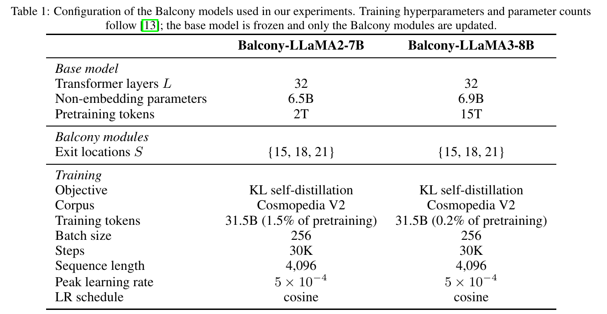
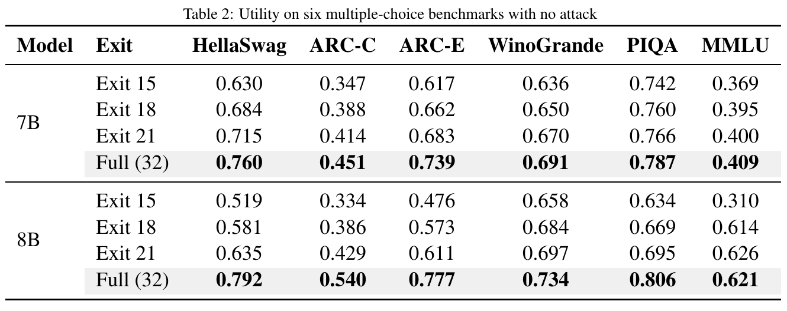
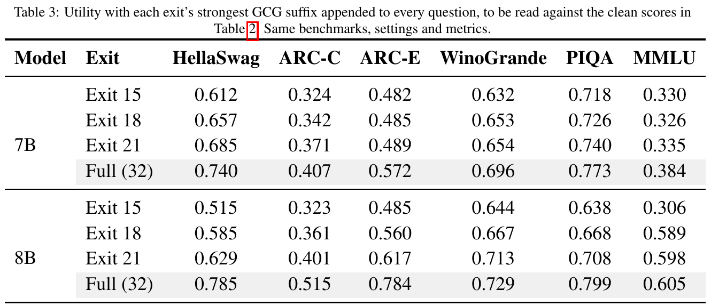

# Jailbreaks across model depth

How does early exit change a language model's vulnerability to jailbreaks?
We study GCG attacks on Balcony-LLaMA2-7B and Balcony-LLaMA3-8B at layers
15, 18, 21, and full depth (32), using HarmBench and AdvBench.

TAO is a planned extension with experimental code. The earlier 1B runs were
development tests; neither contributes results to this study.

## Results

GCG over 150 steps on 50 behaviors per benchmark. The figures and tables below
come directly from the paper, which is the source of truth for reported results.


<details open>
<summary>Loss curves and loss versus attack success</summary>


</details>

<details>
<summary>Paper tables</summary>







</details>

## Run

Requires Linux, Python 3.12, an NVIDIA GPU, and a driver compatible with CUDA 12.8.
From the repository root, install the environment and start a small GCG run:

```bash
bash scripts/setup.sh
.venv/bin/python scripts/run.py experiment --model 7b --stage gcg \
  --benchmarks harmbench --n-behaviors 2 --num-steps 5 --results-dir runs/pilot
```

Setup initializes submodules, applies toolkit patches, and installs `.venv/`.
For gated checkpoints, accept their Hugging Face licenses and run
`.venv/bin/hf auth login`.

For GCG, judging, and utility evaluation at all exits:

```bash
.venv/bin/python scripts/run.py experiment --model 7b
```

Choose `--model 7b` or `--model 8b`. New outputs go to `runs/<model>/`.
Use `--dry-run` to inspect commands without loading models.
[Command reference](scripts/README.md).

## Repository

| Path | Contents |
| --- | --- |
| `adapter/` | Early-exit model code and wrappers |
| `experiments/` | Attack, evaluation, and analysis implementations |
| `scripts/` | Setup and the shared runner |
| `results*/` | Historical run artifacts |
| `paper_figures/published/`, `paper_tables/published/` | Figures and tables extracted from the paper |

Raw archives and older exports are not synchronized with the paper. Keep 7B
runs with and without chat templates separate.

Dependencies are pinned in `.gitmodules`; toolkit fixes are in `patches/`.
