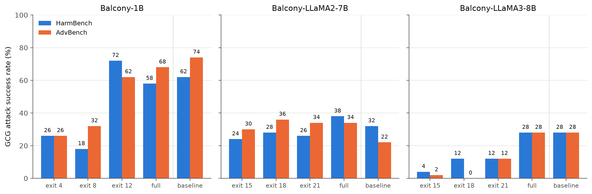
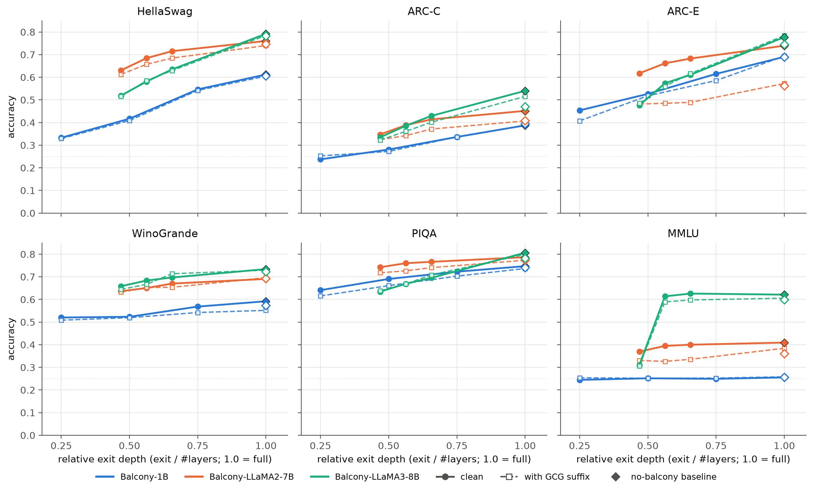
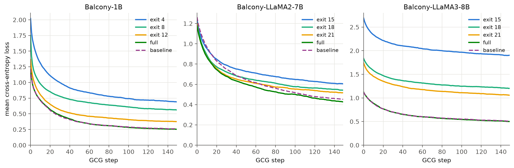
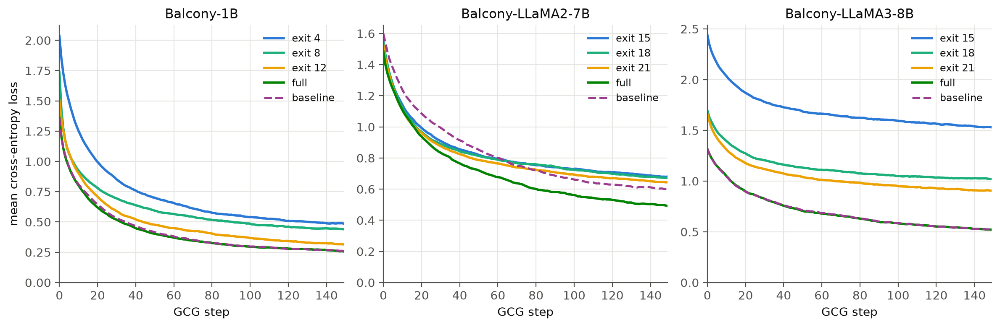
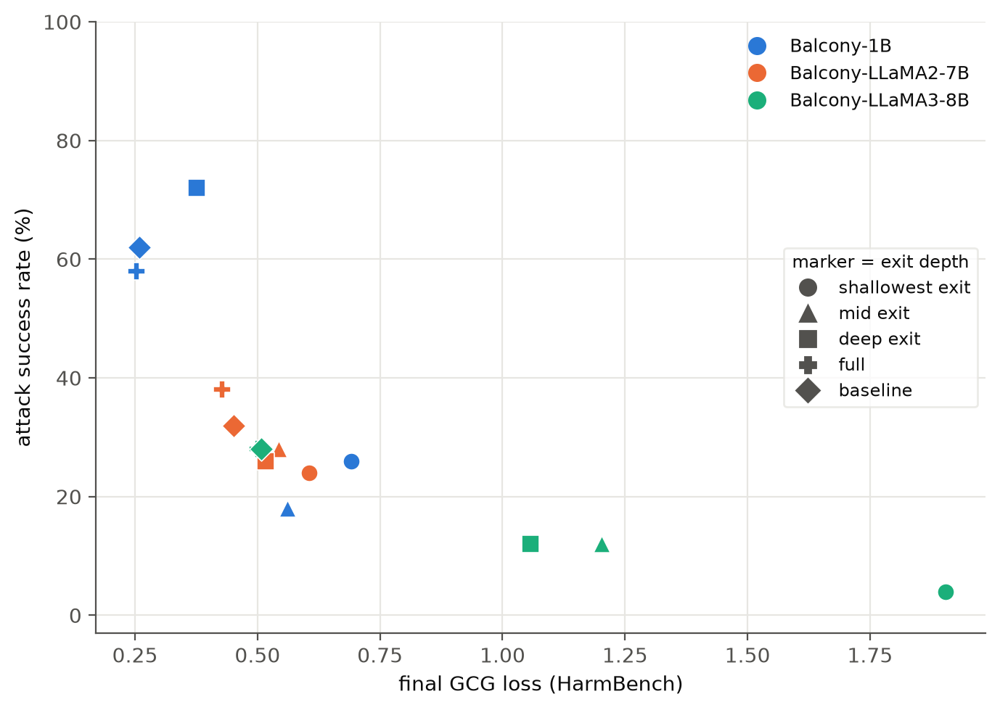
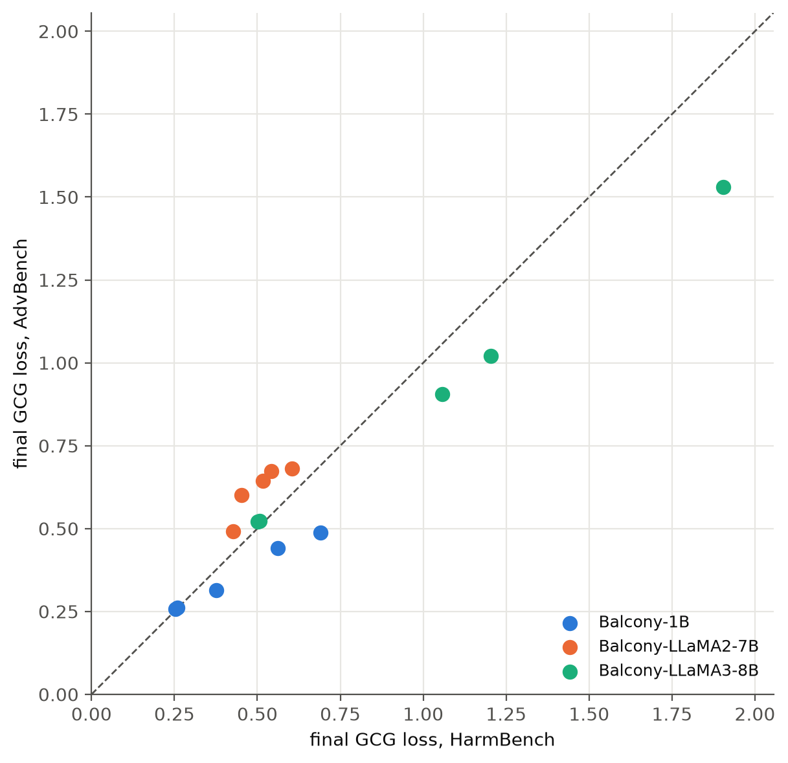

# Jailbreaks across model depth

How does early exit change a language model's vulnerability to jailbreaks?
We test GCG and TAO attacks at different depths of Balcony models, then measure
attack success, transfer between exits, and performance on ordinary tasks.

The recorded experiments cover 1B, LLaMA 2 7B, and LLaMA 3 8B checkpoints on
HarmBench and AdvBench. [Results and data notes](RESULTS.md).

## Figures

Attack success across exits and models:



Performance on ordinary tasks, before and after adding an attack suffix:



<details>
<summary>Loss curves and other comparisons</summary>






</details>

These figures use the archived result sets. The 7B template-free reruns are a
separate variant; see the [data notes](RESULTS.md).

## Run

For GPU experiments, follow [setup](SETUP.md), then start with a small run:

```bash
.venv/bin/python scripts/run.py experiment --model 7b --stage gcg \
  --benchmarks harmbench --n-behaviors 2 --num-steps 5 --results-dir runs/pilot
```

Run the complete experiment suite for one model:

```bash
.venv/bin/python scripts/run.py experiment --model 7b
```

New outputs go to `runs/<model>/`. Add `--dry-run` to inspect commands or
`--help` to see the available stages. [Command reference](scripts/README.md).

## Code and data

| Path | Contents |
| --- | --- |
| `adapter/` | Early-exit model code and wrappers |
| `experiments/` | Attack, evaluation, and analysis implementations |
| `scripts/` | Setup and the shared command line runner |
| `results*/` | Recorded outputs, including rerun variants |
| `paper_figures/`, `paper_tables/` | Figures and exported tables |

The three Git submodules pin [AdversariaLLM](https://github.com/LLM-QC/AdversariaLLM),
[Balcony-LLaMA](https://github.com/benyaminjami/Balcony-LLaMA), and
[TAO-Attack](https://github.com/ZevineXu/TAO-Attack). Local toolkit fixes are in `patches/`.
